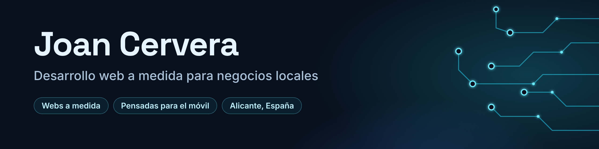
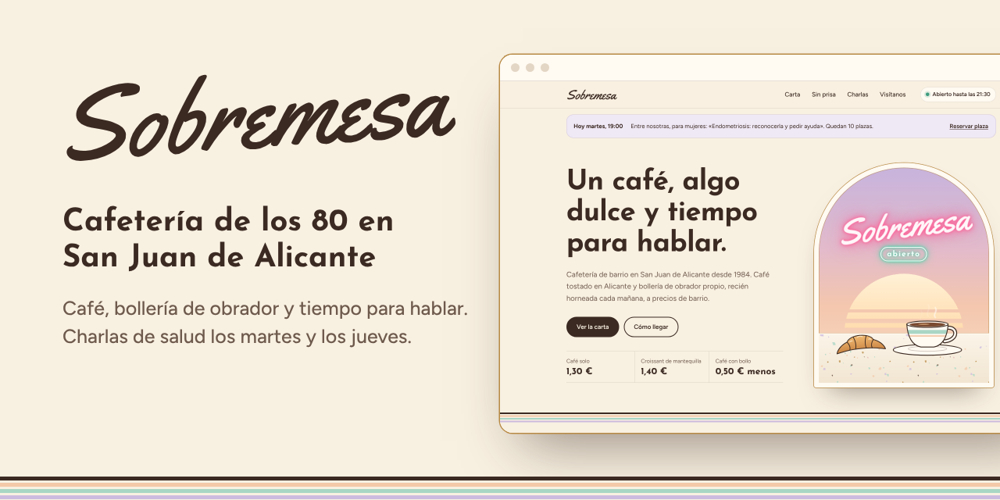
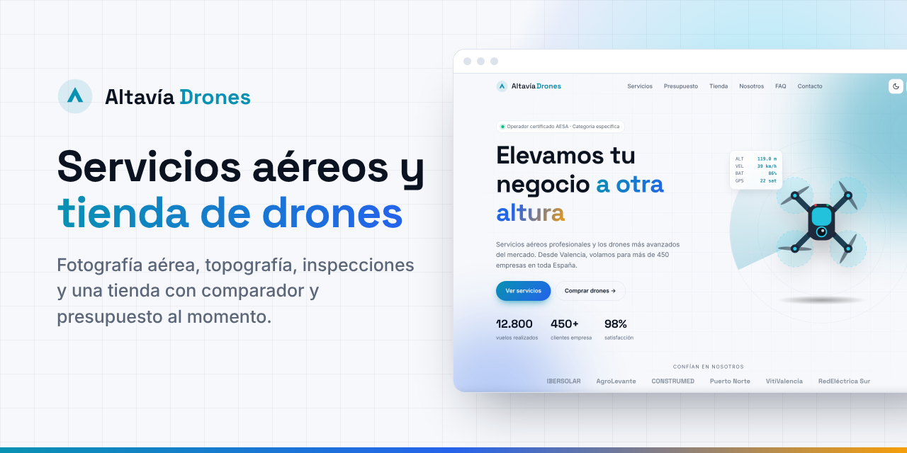
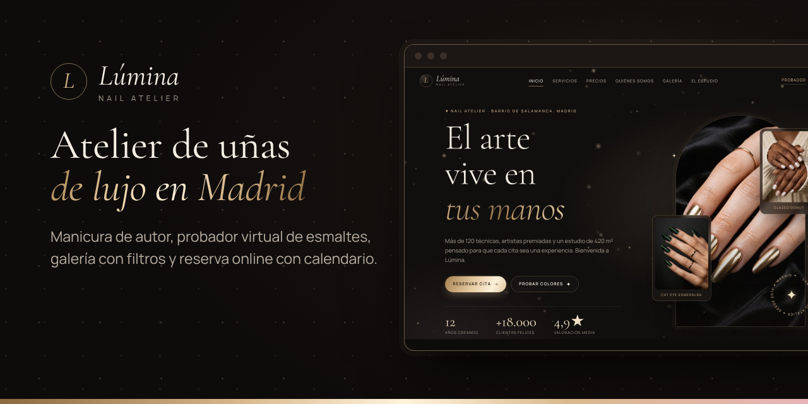

  

### Hola, soy Joan 👋

Hago webs para negocios locales: cafeterías, tiendas, empresas de servicios… Webs rápidas, que se ven bien en el móvil y que el propio negocio puede actualizar sin complicarse.

Trabajo con HTML, CSS y JavaScript, uso Git y GitHub en cada proyecto y me apoyo en la IA para avanzar más rápido sin perder calidad.

## Proyectos

<table>
  <tr>
    <td width="33%" valign="top">
      
      <h3>Cafetería Sobremesa</h3>
      
Cafetería de estilo años 80 en San Juan de Alicante. Carta interactiva que calcula el precio del desayuno, cartel de abierto o cerrado en directo y reserva de plaza para charlas de salud.

      
<a href="https://nivorakk.github.io/Cafeter-a_Web/"><b>Ver la web</b></a>&nbsp;&nbsp;|&nbsp;&nbsp;<a href="https://github.com/Nivorakk/Cafeter-a_Web">Ver el código</a>

    </td>
    <td width="33%" valign="top">
      
      <h3>Altavía Drones</h3>
      
Web corporativa de una empresa de drones con servicios y tienda. Calculadora de presupuesto, filtros de productos, comparador de drones y carrito de compra.

      
<a href="https://nivorakk.github.io/Drones_web/"><b>Ver la web</b></a>&nbsp;&nbsp;|&nbsp;&nbsp;<a href="https://github.com/Nivorakk/Drones_web">Ver el código</a>

    </td>
    <td width="33%" valign="top">
      
      <h3>Lúmina Nails</h3>
      
Atelier de uñas de lujo en el Barrio de Salamanca. Probador virtual de esmaltes, galería con filtros, test de estilo y reserva online con calendario.

      
<a href="https://nivorakk.github.io/Manicura_WEB/"><b>Ver la web</b></a>&nbsp;&nbsp;|&nbsp;&nbsp;<a href="https://github.com/Nivorakk/Manicura_WEB">Ver el código</a>

    </td>
  </tr>
</table>

Los tres proyectos son demostraciones con datos ficticios.

## Qué puedo hacer por tu negocio

- **Una web con tu estilo**, diseñada para ti y no a partir de una plantilla genérica.
- **Pensada para el móvil**, que es desde donde te buscan tus clientes.
- **Tu carta, catálogo o servicios** organizados y fáciles de actualizar.
- **Formularios** de contacto y de reservas.
- **Publicación en internet** para que la compartas con un enlace.

## Herramientas

## Contacto

¿Tienes un negocio y necesitas una web? Escríbeme y lo hablamos.

